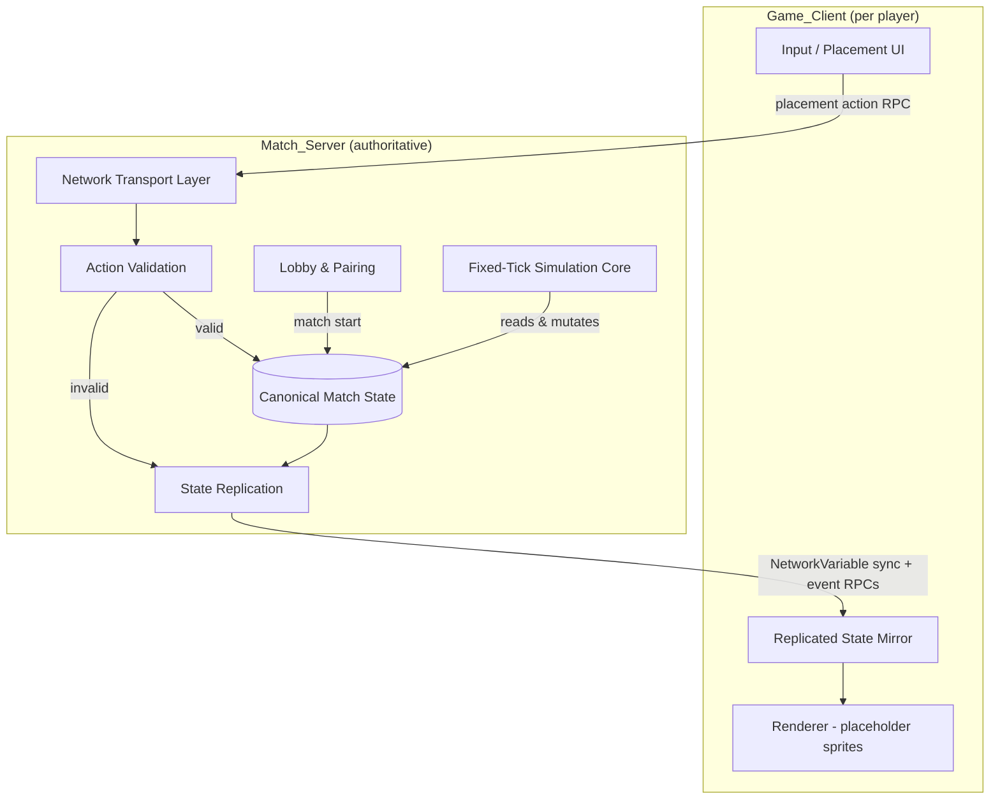
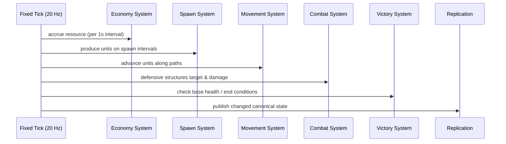

# Design Document

## Overview

This document describes the design for a 2D top-down real-time strategy (RTS) game built in Unity supporting 1v1 online multiplayer. The defining gameplay twist is that players do not directly command units: units spawn automatically from `Spawner_Structure`s and travel along predefined `Path`s toward the opponent's `Base`. The player's only agency is the placement of `Structure`s (spawners, defensive, economy) within their `Build_Area`, funded by a `Resource` economy.

The system is **server-authoritative**. A `Match_Server` owns the canonical game state and resolves all game logic on a fixed simulation tick. `Game_Client`s are responsible only for capturing player placement intent, rendering replicated state with placeholder graphics, and displaying match outcome. This separation guarantees that both participants observe a consistent, fair outcome (Requirement 2) and prevents a client from fabricating units, resources, or base damage.

### Key Design Decisions

| Decision | Choice | Rationale |
| --- | --- | --- |
| Networking stack | Unity Netcode for GameObjects (NGO) | Server-authoritative model with fixed time-step simulation is a first-class concept, and GameObject/MonoBehaviour-based so placeholder sprites are trivial. ([Netcode time synchronization](https://docs.unity3d.com/Packages/com.unity.netcode@1.0/manual/time-synchronization.html)) |
| State replication | `NetworkVariable` for persistent canonical state; RPCs for one-off events | `NetworkVariable` auto-syncs to current *and* late-joining/reconnecting clients, which satisfies the "resend on reconnection" criteria (2.6, 8.7). RPCs are point-in-time and not delivered to absent clients, so they are reserved for rejection responses and transient notifications. ([Synchronizing states and events](https://docs.unity3d.com/Packages/com.unity.netcode.gameobjects@1.13/manual/advanced-topics/ways-to-synchronize.html)) |
| Simulation model | Fixed tick (default 20 Hz, configurable) driven from `FixedUpdate` | Requirement 6.1 mandates position updates at least 20 times per second; a fixed tick gives deterministic, reproducible logic independent of client framerate. ([server-authoritative movement](https://forum.unity.com/threads/tips-for-server-authoritative-player-movement.199538/)) |
| Server topology | Dedicated-server-capable host (one authoritative instance per match) | Requirement 2.1 names a single source of truth; a dedicated/host authority is the simplest model that satisfies it for a 1v1 scope. |
| Graphics | Placeholder sprites only, data-driven by owner color and structure type | Requirement 10 explicitly defers final art to the user. |

Content from Unity documentation and community sources above was rephrased for compliance with licensing restrictions.

## Architecture

The system splits cleanly into three layers, mirroring the Glossary roles. All game logic lives server-side; the client is a thin presentation layer.



### Simulation Core

The simulation core runs a deterministic ordered pipeline on every fixed tick. Ordering matters for consistency (e.g., economy before placement validation, movement before combat, combat before victory checks):



Player placement actions are not part of the fixed pipeline; they arrive asynchronously via RPC, are validated immediately (Requirement 2.2 requires validation within 100 ms of receipt), and applied to the canonical state so the next tick observes them.

### Networking Model

- **Client to server:** placement intent is sent as a `ServerRpc` carrying `{structureType, targetLocation, placingPlayerId}`. The client never mutates authoritative state.
- **Server to all clients (persistent):** unit positions, structures, resource totals, base health, and match phase are exposed as `NetworkVariable`s / networked objects so a reconnecting client is automatically brought current (satisfies 2.6, 8.7).
- **Server to specific client (transient):** placement/action rejections are sent as a targeted `ClientRpc` to the submitting client only (Requirements 2.4, 3.4, 4.2–4.4).
- **Server to all clients (transient events):** unit removal notifications (Requirement 7.5) are `ClientRpc`s; clients absent at send time are excluded (7.6) but reconcile via persistent state on reconnect.

## Components and Interfaces

### MatchServer

Top-level authoritative coordinator. Owns the canonical state and the fixed-tick loop.

```csharp
public interface IMatchServer
{
    MatchState State { get; }
    void Tick(float deltaSeconds);              // fixed-step simulation entry
    ActionResult SubmitAction(PlayerAction action); // validate + apply or reject
    void OnClientConnected(PlayerId id);
    void OnClientDisconnected(PlayerId id);
}
```

### LobbyManager

Handles pairing before a match (Requirement 1).

```csharp
public interface ILobbyManager
{
    JoinResult RequestJoin(PlayerId id);        // reject if already assigned (1.2)
    bool TryStartMatch(out MatchDescriptor match); // when 2 players present (1.3, 1.7)
    void TickWaiting(float deltaSeconds);       // enforce 120s timeout (1.4, 1.5)
    void RemovePlayer(PlayerId id);             // on disconnect (1.6)
}
```

### ResourceSystem

Owns resource accrual and spending (Requirement 3).

```csharp
public interface IResourceSystem
{
    void StartMatch(PlayerId a, PlayerId b);    // set 100 each (3.1)
    void AccrueTick(float deltaSeconds);        // economy generation, cap 999,999 (3.2)
    bool CanAfford(PlayerId id, int cost);
    bool TrySpend(PlayerId id, int cost);       // decrease on success (3.3)
    int GetTotal(PlayerId id);
}
```

### PlacementSystem

Validates and applies structure placement (Requirement 4).

```csharp
public interface IPlacementSystem
{
    PlacementResult TryPlace(PlacementAction action);
    // Validation order: within Build_Area (4.2) -> no footprint overlap (4.3)
    //                   -> affordable (4.4) -> create + assign owner + spend (4.5)
}
```

### SpawnSystem

Produces units from active spawners (Requirement 5).

```csharp
public interface ISpawnSystem
{
    void Tick(float deltaSeconds);  // emit units on each spawn interval (5.1)
    // Assigns owner id (5.2) and path to opponent base (5.3) before activation.
    // Holds pending unit if spawn point occupied (5.5) or no path (5.6).
}
```

### MovementSystem

Advances units along paths (Requirement 6).

```csharp
public interface IMovementSystem
{
    void Tick(float deltaSeconds); // move toward next waypoint at unit speed (6.1)
    // Waypoint reached within 0.1 map units -> advance (6.2)
    // Final waypoint at opponent base -> damage base + remove unit (6.3)
    // No further waypoints, not at base -> halt, no damage (6.4)
}
```

### CombatSystem

Resolves defensive structures versus units (Requirement 7).

```csharp
public interface ICombatSystem
{
    void Tick(float deltaSeconds);
    // Target = furthest-progressed enemy unit in range (7.1)
    // Apply damage once per attack interval while target in range (7.2)
    // No target when interval elapses -> no damage, retain timing (7.3)
    // Unit health <= 0 -> remove within one tick (7.4) + notify (7.5)
}
```

### VictorySystem

Determines match end (Requirements 8, 9).

```csharp
public interface IVictorySystem
{
    MatchOutcome? Evaluate();   // base at 0 -> end (8.1); winner/loser/draw (8.2-8.4)
    void OnDisconnectTimeout(PlayerId id); // disconnect resolution (9.1, 9.2, 9.5)
}
```

### GameClient (presentation only)

```csharp
public interface IGameClient
{
    void SubmitPlacement(StructureType type, Vector2 location); // -> ServerRpc (4.1)
    void OnStateReplicated(MatchStateSnapshot snapshot);        // render (6.5, 10.x)
    void OnActionRejected(RejectionReason reason);              // (2.4, 3.4, 4.2-4.4)
    void OnMatchResult(MatchOutcome outcome);                   // (8.5, 9.3)
}
```

## Data Models

```csharp
// Identity
public readonly struct PlayerId { public uint Value; }
public readonly struct UnitId { public uint Value; }
public readonly struct StructureId { public uint Value; }

public enum StructureType { Spawner, Defensive, Economy }
public enum MatchPhase { Lobby, Active, Paused, Ended }
public enum MatchOutcomeKind { Winner, Draw, NoContest }

// Geometry
public readonly struct MapVector { public float X; public float Y; }        // map units
public readonly struct Footprint { public MapVector Origin; public MapVector Size; }

public sealed class Path
{
    public IReadOnlyList<MapVector> Waypoints;   // ordered spawn -> opponent base
    public MapVector TargetBase;
}

// Entities
public sealed class Unit
{
    public UnitId Id;
    public PlayerId Owner;
    public MapVector Position;
    public float Health;          // > 0 while active
    public float MovementSpeed;   // map units / second
    public float Damage;          // applied to base on arrival
    public Path AssignedPath;
    public int WaypointIndex;     // current target waypoint
    public bool IsHeld;           // true when waiting for free spawn point or path (5.5, 5.6)
}

public sealed class Structure
{
    public StructureId Id;
    public PlayerId Owner;
    public StructureType Type;
    public Footprint Footprint;
    public bool IsActive;
    public int Cost;
    // Spawner fields
    public float SpawnIntervalSeconds;   // 1..600 (5.1)
    public MapVector SpawnPoint;
    public float SpawnTimer;
    // Defensive fields
    public float Range;
    public float AttackInterval;
    public float AttackDamage;
    public float AttackTimer;
    public UnitId? CurrentTarget;
    // Economy fields
    public int GenerationRate;           // resources per interval (3.2)
    public float GenerationTimer;
}

public sealed class PlayerState
{
    public PlayerId Id;
    public int ResourceTotal;    // 0..999,999 (3.1, 3.2)
    public float BaseHealth;     // 0..maxHealth
    public float BaseMaxHealth;
    public MapVector BaseLocation;
    public Build_Area BuildArea;
    public ConnectionState Connection;  // Connected, Disconnected, ReconnectWindow
}

public sealed class Build_Area { public IReadOnlyList<Footprint> Regions; }

// Canonical match state (single source of truth, Requirement 2.1)
public sealed class MatchState
{
    public MatchPhase Phase;
    public IReadOnlyDictionary<PlayerId, PlayerState> Players;  // exactly 2
    public IReadOnlyDictionary<UnitId, Unit> Units;
    public IReadOnlyDictionary<StructureId, Structure> Structures;
    public MatchOutcome? Outcome;
    public long Tick;
}

public sealed class MatchOutcome
{
    public MatchOutcomeKind Kind;
    public PlayerId? Winner;
    public PlayerId? Loser;
}

// Actions & results
public sealed class PlacementAction
{
    public PlayerId PlacingPlayer;
    public StructureType Type;
    public MapVector TargetLocation;
}

public enum RejectionReason { NotInBuildArea, FootprintOverlap, InsufficientResources, MatchEnded, OutOfBounds }
public sealed class PlacementResult { public bool Success; public StructureId? Created; public RejectionReason? Reason; }
```

### Economy and spending constants

| Constant | Value | Source |
| --- | --- | --- |
| Starting resources | 100 | AC 3.1 |
| Economy generation interval | 1 second | AC 3.2 |
| Resource cap | 999,999 | AC 3.2 |
| Spawn interval range | 1–600 seconds | AC 5.1 |
| Waypoint reach threshold | 0.1 map units | AC 6.2 |
| Minimum position update rate | 20 Hz | AC 6.1 |
| Lobby capacity | 2 players | AC 1.1 |
| Lobby wait timeout | 120 seconds | AC 1.5 |
| Lobby disconnect removal | within 5 seconds | AC 1.6 |
| Reconnection window | 30 seconds | AC 9.1 |

## Correctness Properties

*A property is a characteristic or behavior that should hold true across all valid executions of a system-essentially, a formal statement about what the system should do. Properties serve as the bridge between human-readable specifications and machine-verifiable correctness guarantees.*

The following properties were derived from the acceptance criteria. Latency/networking criteria (2.2, 2.5, 3.5, 4.6, 6.5, 7.5, 8.5, 9.3) and the architectural single-source-of-truth criterion (2.1) are validated by timing/integration tests rather than properties and are listed in the Testing Strategy. Redundant criteria were consolidated during property reflection (3.4 with 4.4; 5.2 with 5.3; 8.2/8.3/8.4; 9.1/9.2/9.5).

### Property 1: Lobby never exceeds two players

*For any* sequence of join requests from unassigned players, no `Lobby` ever contains more than two `Players`, and every accepted joiner is placed into a `Lobby`.

**Validates: Requirements 1.1**

### Property 2: Assigned players cannot re-join

*For any* `Player` already assigned to a `Lobby` or `Match`, a subsequent join request is rejected and that `Player`'s prior assignment is identical before and after the request.

**Validates: Requirements 1.2**

### Property 3: A full lobby starts a match

*For any* `Lobby` reaching exactly two `Players`, the `Lobby` transitions to a started `Match` for those two `Players`.

**Validates: Requirements 1.3**

### Property 4: Lobby wait timeout removes the waiting player

*For any* wait schedule in which 120 seconds elapse while a `Lobby` still holds fewer than two `Players`, the waiting `Player` is removed and a no-opponent signal is produced; while fewer than 120 seconds have elapsed, the waiting `Player` is retained.

**Validates: Requirements 1.4, 1.5**

### Property 5: Lobby disconnect removes only the departing player

*For any* `Lobby` from which one `Player` disconnects before match start, after processing the disconnected `Player` is absent and any remaining waiting `Player` is retained.

**Validates: Requirements 1.6**

### Property 6: Match start assigns unique ids and bases

*For any* started `Match`, the two assigned player identifiers are distinct and each `Player` is assigned a starting `Base`.

**Validates: Requirements 1.7**

### Property 7: Valid actions apply exactly once

*For any* valid `PlayerAction`, applying it produces exactly one change to the canonical state, and re-delivery of the same action identifier produces no additional change.

**Validates: Requirements 2.3**

### Property 8: Invalid actions leave state unchanged

*For any* `PlayerAction` that is invalid against the canonical state, the canonical state before applying equals the canonical state after, and a rejection response is produced for the submitting client.

**Validates: Requirements 2.4**

### Property 9: Reconnecting clients converge to canonical state

*For any* canonical `MatchState`, a client that becomes reachable again receives state equal to the current canonical state (including a stored `MatchOutcome` when the `Match` has ended).

**Validates: Requirements 2.6, 8.7**

### Property 10: Economy accrual respects rate and cap

*For any* number of generation intervals `n` and generation rate `r` for an active `Economy_Structure`, the owner's `Resource` total equals `min(start + r * n, 999999)`, and never exceeds 999,999.

**Validates: Requirements 3.2**

### Property 11: Affordable spending decrements exactly by cost

*For any* `PlayerState` whose `Resource` total is greater than or equal to a `Structure`'s cost, applying the spend decreases that `Player`'s `Resource` total by exactly the cost.

**Validates: Requirements 3.3**

### Property 12: Unaffordable placement is rejected with state unchanged

*For any* placement whose `Structure` cost exceeds the placing `Player`'s current `Resource` total, the placement is rejected with an insufficient-resources indication and the `Match` state (including the `Resource` total) is unchanged.

**Validates: Requirements 3.4, 4.4**

### Property 13: Out-of-build-area placement is rejected with state unchanged

*For any* placement whose target location lies outside the placing `Player`'s `Build_Area`, the placement is rejected and the `Match` state is unchanged.

**Validates: Requirements 4.2**

### Property 14: Placed structures never overlap

*For any* placement whose footprint intersects an existing `Structure`'s footprint, the placement is rejected and the `Match` state is unchanged; consequently, across any sequence of accepted placements, no two `Structure` footprints overlap.

**Validates: Requirements 4.3**

### Property 15: Valid placement creates an owned structure and charges its cost

*For any* placement that is inside the placing `Player`'s `Build_Area`, has no footprint overlap, and is affordable, a `Structure` is created at the target location owned by the placing `Player`, and that `Player`'s `Resource` total decreases by the `Structure`'s cost.

**Validates: Requirements 4.5**

### Property 16: Active spawners emit units on their interval

*For any* active `Spawner_Structure` with spawn interval in [1, 600] seconds, the number of `Units` created over an unobstructed duration equals the number of spawn intervals elapsed.

**Validates: Requirements 5.1**

### Property 17: Created units carry owner and a base-targeted path

*For any* created `Unit`, before it becomes active its owning `Player` identifier equals its `Spawner_Structure`'s owner and, when a `Path` is available, its assigned `Path` targets the opponent's `Base`.

**Validates: Requirements 5.2, 5.3**

### Property 18: Inactive spawners produce no units

*For any* schedule during which a `Spawner_Structure` is inactive, no `Unit` is created for any spawn interval that elapses while it is inactive.

**Validates: Requirements 5.4**

### Property 19: Blocked spawns are conserved, not lost or duplicated

*For any* schedule where the spawn point is occupied at interval start and later becomes unoccupied, the pending `Unit` is created exactly once when the spawn point becomes free.

**Validates: Requirements 5.5**

### Property 20: Pathless units are held with owner retained

*For any* `Unit` created when no `Path` toward the opponent's `Base` is available, the `Unit` remains at the spawn point without movement and retains its owning `Player` identifier until a `Path` becomes available.

**Validates: Requirements 5.6**

### Property 21: Units advance toward the next waypoint by speed times time

*For any* active, moving `Unit` and tick duration `dt`, the `Unit`'s position moves toward its current target waypoint by its movement speed times `dt`, clamped so it does not overshoot the waypoint.

**Validates: Requirements 6.1**

### Property 22: Reaching a waypoint advances the path index

*For any* `Unit` whose distance to its current target waypoint is within 0.1 map units, the waypoint is treated as reached and the `Unit` advances toward the next waypoint on its `Path`.

**Validates: Requirements 6.2**

### Property 23: Arrival at the opponent base damages it and removes the unit

*For any* `Unit` that reaches the final waypoint of its `Path` at the opponent's `Base`, the opponent's `Base` health decreases by the `Unit`'s defined damage and the `Unit` is removed from the `Match`.

**Validates: Requirements 6.3**

### Property 24: Dead-end paths halt units without damage

*For any* `Unit` with no further waypoints that is not located at the opponent's `Base`, the `Unit` stops moving, remains at its current position, and applies no damage to any `Base`.

**Validates: Requirements 6.4**

### Property 25: Defensive structures target the furthest-progressed enemy

*For any* configuration of enemy `Units` within a `Defensive_Structure`'s range, the selected target is the single enemy `Unit` that has progressed furthest along its `Path`.

**Validates: Requirements 7.1**

### Property 26: Damage is applied once per attack interval while in range

*For any* duration a target `Unit` remains within a `Defensive_Structure`'s range, the number of damage applications equals the number of that structure's attack intervals elapsed over the duration.

**Validates: Requirements 7.2**

### Property 27: Empty range applies no damage and preserves timing

*For any* attack interval that elapses while a `Defensive_Structure`'s range contains no enemy `Unit`, no damage is applied and the structure's accumulated attack-interval timing is retained.

**Validates: Requirements 7.3**

### Property 28: Units at or below zero health are removed within one tick

*For any* applied damage that reduces a `Unit`'s health to zero or below, that `Unit` is absent from the `Match` state after the tick in which its health reached zero.

**Validates: Requirements 7.4**

### Property 29: Removal notifications target only connected clients

*For any* set of connected and disconnected `Game_Clients` at the time a `Unit` is removed, the removal completes and the set of notification recipients equals exactly the connected clients.

**Validates: Requirements 7.6**

### Property 30: A base at zero health ends the match

*For any* `MatchState` in which a `Player`'s `Base` health reaches zero, evaluation transitions the `Match` to the ended state.

**Validates: Requirements 8.1**

### Property 31: Match outcome is determined by base health

*For any* ended `Match`, if exactly one `Player`'s `Base` reached zero health the surviving `Player` is the winner and the zero-health `Player` is the loser; if both `Bases` reached zero health in the same simulation update the result is a draw with no winner and no loser.

**Validates: Requirements 8.2, 8.3, 8.4**

### Property 32: Ended matches reject further actions and freeze the result

*For any* gameplay action submitted while a `Match` is in the ended state, the action is rejected and the recorded `MatchOutcome` remains unchanged.

**Validates: Requirements 8.6**

### Property 33: Disconnection timeout resolves the match

*For any* disconnection that is not resolved within the 30-second reconnection window: if exactly one `Player` remains connected that `Player` is declared the winner, and if both `Players` are disconnected when the window expires the `Match` ends with no declared winner.

**Validates: Requirements 9.1, 9.2, 9.5**

### Property 34: Pause then timely reconnect restores the match

*For any* disconnection followed by a reconnection before the 30-second window expires, the `Match` returns to the active state with its pre-pause canonical state preserved (pause/resume round-trip).

**Validates: Requirements 9.4**

### Property 35: Unit render color is unique per owner

*For any* two `Units`, the assigned placeholder render colors differ when their owning `Players` differ and are identical when their owners are the same.

**Validates: Requirements 10.1**

### Property 36: Structure render sprite is unique per type

*For any* two `Structures`, the mapped placeholder sprites differ when their `StructureType`s differ and are identical when their types are the same.

**Validates: Requirements 10.2**

### Property 37: Rendered numeric values equal the canonical integer value

*For any* `Resource` total in [0, 999,999,999] and any `Base` health in [0, max health], the rendered display equals that value formatted as an integer.

**Validates: Requirements 10.3, 10.4**

### Property 38: Missing sprites fall back without interrupting rendering

*For any* `Unit` or `Structure` lacking an assigned placeholder sprite for its owner or type, the resolver returns the default fallback sprite and rendering of all other game objects proceeds.

**Validates: Requirements 10.5**

## Error Handling

Errors in a server-authoritative design fall into three categories: rejected player actions, transport failures, and internal simulation faults. The guiding rule is that the canonical state only ever advances through validated, deterministic transitions; any error leaves the canonical state well-defined.

### Rejected player actions

Invalid actions never mutate canonical state. Validation runs before application, and a typed `RejectionReason` is returned to the submitting client via a targeted `ClientRpc`:

| Condition | Reason | Requirements |
| --- | --- | --- |
| Target outside map bounds | `OutOfBounds` | 4.1 |
| Target outside build area | `NotInBuildArea` | 4.2 |
| Footprint overlaps existing structure | `FootprintOverlap` | 4.3 |
| Cost exceeds resource total | `InsufficientResources` | 3.4, 4.4 |
| Action submitted after match ended | `MatchEnded` | 8.6 |

The client surfaces the rejection to the player (e.g., placement preview flashes invalid) and takes no state-changing action of its own.

### Transport and connection failures

- **Unreachable client on state push:** the server does not block the simulation. Canonical state is retained; because persistent state uses `NetworkVariable`s, the client is resynchronized automatically on reconnection (Requirements 2.6, 8.7).
- **Client disconnect during a match:** the `Match` enters `Paused` and a 30-second reconnection timer starts (Requirement 9.4). Reconnection within the window resumes the match from preserved state; expiry resolves the match per Property 33.
- **Transient event delivery to absent clients:** unit-removal and result RPCs exclude disconnected clients (Requirements 7.6, 8.7, 9.3); those clients reconcile through persistent state on reconnection.

### Internal simulation faults

- **No path available for a new unit:** the unit is held at the spawn point rather than discarded (Requirement 5.6, Property 20).
- **Occupied spawn point:** pending creation is retained and fulfilled when the point frees (Requirement 5.5, Property 19).
- **Dead-end path (no further waypoints, not at base):** the unit halts safely with no base damage (Requirement 6.4, Property 24).
- **Missing placeholder sprite:** the renderer falls back to a default sprite and continues (Requirement 10.5, Property 38), so a content gap never halts rendering.
- **Resource cap overflow:** accrual clamps at 999,999 (Requirement 3.2, Property 10).

Simulation steps are written to be total over their valid input domain (clamping, holding, or no-op rather than throwing), so a single entity in an unexpected state cannot abort a tick for all entities.

## Testing Strategy

The feature is dominated by pure, server-side game logic with large input spaces and strong invariants, so property-based testing is the primary strategy, complemented by example/edge unit tests and a small number of integration/timing tests for networking and latency criteria.

### Property-based testing

- **Library:** use an established property-based testing library for the target language (for C#/Unity, FsCheck or CsCheck). Property tests MUST NOT be implemented from scratch.
- **Iterations:** each property test runs a minimum of 100 generated iterations.
- **Traceability:** each property test is tagged with a comment referencing its design property, using the format: **Feature: multiplayer-rts, Property {number}: {property_text}**.
- **Coverage:** each of Properties 1–38 is implemented by a single property-based test.
- **Generators:** custom generators produce random lobbies and join sequences, player/resource/structure states, build areas and footprints (including overlapping and boundary cases), spawn/attack schedules, paths and waypoint positions (including the 0.1-unit boundary), unit sets with varied path progression, and connection-state sets. Economy generators include values at and beyond the 999,999 cap; spawn-interval generators cover the [1, 600] range; formatter generators cover the full [0, 999,999,999] and [0, max] ranges.
- **Mocks:** the simulation core is tested against an in-memory state and mocked transport so properties run cheaply without real network or AWS/Unity runtime costs.

### Example and edge-case unit tests

- Match-start initialization: both players start at exactly 100 resources (AC 3.1).
- Client placement message construction carries type, location, and placing player (AC 4.1).
- Boundary cases that back specific generators: waypoint-reach at exactly 0.1 map units (AC 6.2), lobby wait just below and just above 120 seconds (ACs 1.4, 1.5), reconnection at the 30-second edge (AC 9.1).

### Integration and timing tests

These criteria concern replication latency and infrastructure wiring rather than input-varying logic, so they use a small number of representative executions rather than property tests:

- Action validation latency within 100 ms (AC 2.2).
- State replication to each client within 200 ms (ACs 2.5, 3.5).
- Structure creation replicated within 1 second (AC 4.6).
- Client renders reported unit position within 100 ms (AC 6.5).
- Removal notification dispatch within one tick (AC 7.5).
- Match-result delivery within 2 seconds (AC 8.5) and disconnection result within 5 seconds (AC 9.3).
- Rendered value latency within 500 ms (ACs 10.3, 10.4).
- Single source of truth: an integration check that clients derive state only from server replication (AC 2.1).
